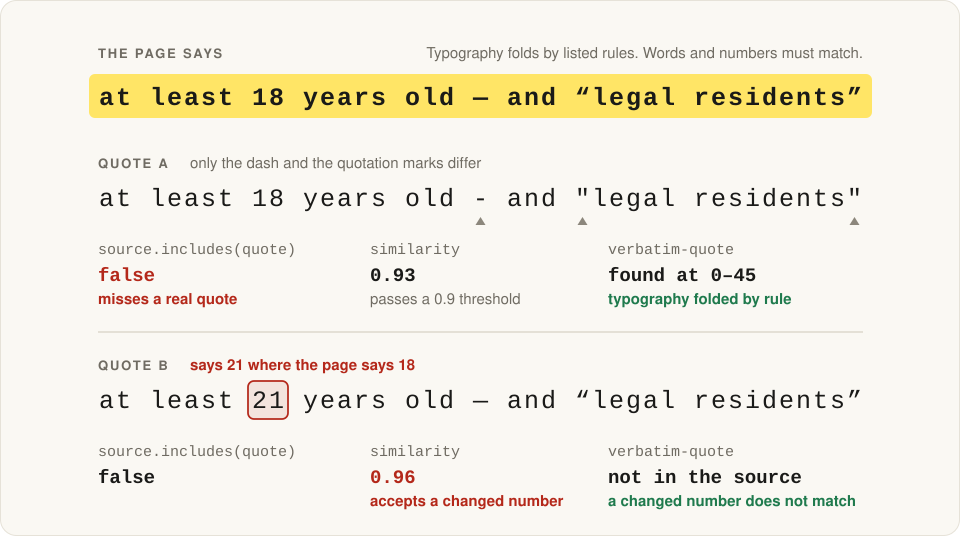

# verbatim-quote

verbatim-quote checks that a quote really appears in its source, character for character, and gives you offsets into the original text.
Scored by plain similarity, a quote that says 21 where the source says 18 still gets 0.96. verbatim-quote rejects it.
Only listed typography differences, such as curly quotes and dash variants, are folded before the exact comparison. It does not check what a quote means.

<picture>
  <source media="(prefers-color-scheme: dark)" srcset="docs/hero-dark.svg">
  
</picture>

```bash
npm install github:ninondev/verbatim-quote
```

The npm registry release is coming; until then, install from GitHub as above.

```js
import { findQuote, explainMiss } from "verbatim-quote";

const page = "Entrants must be at least 18 years old — and “legal residents” of an eligible country.";

findQuote('at least 18 years old - and "legal residents"', page);
// { start: 17, end: 62, text: 'at least 18 years old — and “legal residents”', parts: [...] }

findQuote("at least 21 years old", page);      // null
explainMiss("at least 21 years old", page);
// { status: 'close', nearest: { start: 17, end: 38, text: 'at least 18 years old' }, distance: 2,
//   differences: [{ kind: 'changed', quote: '21', source: '18', start: 26, end: 28 }] }
```

It is one ES module with no dependencies, and its offsets are grapheme-aware.
It needs `Intl.Segmenter`, so use Node 22 or later.
[Try it in the playground](https://ninondev.github.io/verbatim-quote/).

## Why not `includes()` or a similarity score?

| The source says | The quote claims | `includes()` | similarity ≥ 0.9 | verbatim-quote |
|---|---|---|---|---|
| `at least 18 years old — and “legal residents”` | `at least 18 years old - and "legal residents"` | **misses it** | 0.93, accepts | found |
| `at least 18 years old — and “legal residents”` | `at least 21 years old — and “legal residents”` | rejects | 0.96, **accepts a changed number** | rejects |
| `Entries must not be shared publicly before judging ends` | `Entries must be shared publicly before judging ends` | rejects | 0.93, **accepts a dropped "not"** | rejects |
| `at least 180 days` | `at least 18` | **accepts a cut-off number** | 0.65, rejects | rejects |
| `参赛对象：在校学生` | `参赛对象:在校学生` | **misses it** | 0.89, rejects | found |

"Similarity" here is `1 - distance / length`, with the Levenshtein distance counted in code points and the
length of the longer string, computed by the test suite so the table cannot drift. The 0.9 threshold is an
example, not a claim about any particular library.

`includes()` is too strict for real text and too loose at the edges, and a similarity threshold is too loose
for facts. verbatim-quote compares text using the explicit folding and boundary rules below.

## With model output

Ask the model for its evidence as JSON (`[{ "claim": ..., "quote": ... }]`), run `checkQuotes`, keep only
the claims whose quote was found, and use `explainMiss` to say what was wrong with the others.

```js
import { checkQuotes, explainMiss } from "verbatim-quote";

const page = "Entrants must be at least 18 years old.\nEntries must not be shared publicly before judging ends.";

const evidence = [
  { claim: "Entrants must be 18 or older", quote: "at least 18 years old" },
  { claim: "Entries stay private until judging ends", quote: "Entries must be shared publicly" },
];

const report = checkQuotes(evidence, page);
const kept = report.results.filter((result) => result.match).map((result) => result.claim);
// kept: ["Entrants must be 18 or older"]

const wrong = report.results.find((result) => !result.match);
explainMiss(wrong.quote, page).differences[0].source.includes("not"); // true: the model dropped a "not"
```

## What is forgiven

| Difference | Example |
|---|---|
| Curly and straight quotes | `“legal residents”` = `”legal residents”` |
| Dash variants (including the minus sign) | `18 — 25` = `18 - 25` |
| Runs of whitespace, no-break spaces | `up to four   people` = `up to four people` |
| Width forms (U+FF00 to U+FFEF): full-width letters, digits and punctuation to ASCII, half-width katakana to katakana | `参赛对象：` = `参赛对象:` · `１８` = `18` · `ｶﾀｶﾅ` = `カタカナ` |
| Latin ligatures and the ellipsis character | `final` = `final` · `…` = `...` |
| Composed and decomposed accents | `café` = `café` |
| Invisible characters | soft hyphen, zero-width space, word joiner, BOM (the zero-width joiner and non-joiner are kept: they change words) |

Nothing else folds. Superscripts, fractions, circled numbers and Roman numeral characters stay what they
are, so `1` does not match `½`, `x2` does not match `x²` and `Chapter IV` does not match `Chapter Ⅳ`. Set
`compatibility: true` to fold every character with Unicode NFKC, as earlier development versions did; an expanded
character then matches only as a whole.

After folding, comparison is exact. The default `boundary: "word"` rejects word and number joins such as
`18` in `at least 180 days`, `can` in `can't`, and `refundable` in `non-refundable`.
`boundary: "none"` skips those boundary checks; grapheme clusters must still match as a whole.
Case is kept unless you ask (`ignoreCase`). An ellipsis in the quote stands for omitted text only when
you ask (`allowEllipsis`).

Boundary checks cover adjacent letters, marks, numbers and connector punctuation; apostrophes (`'`, `’`),
hyphens (U+002D, U+2010, U+2011) and full stops `.` between word characters; commas `,`, colons `:` and slashes `/`,
figure dash U+2012, en dash U+2013, em dash U+2014, horizontal bar U+2015 and minus U+2212 between
digits. No-break space U+00A0, narrow no-break space U+202F and thin space U+2009 join digit groups
when the following group has exactly three digits; apostrophe `'` also joins groups such as `1'000`.
Signs `+`, `-` and `−` attach directly to a following digit after the start of text or any character
other than a letter or decimal digit, and also join two digits (`1+18`). A number may not be cut just
before its `%`, `‰` or `°` suffix. Corresponding full-width punctuation has the same rules.
Han, Hiragana, Katakana, Hangul, Thai, Lao, Khmer and
Myanmar allow substrings at adjacent word characters. The same boundary checks apply to both ends
of every piece around an ellipsis.

Folding is a comparison policy, not a guarantee of equivalent meaning. Quotation-mark folding includes
prime symbols (`′`, `″`), which can denote units, and dash folding includes the minus sign.
Review the original source and choose options appropriate to your text.

## Use

```js
import { findQuote, verifyQuote, checkQuotes, splitSentences, sentenceAt } from "verbatim-quote";

const page = "Who can participate\nParticipants must be at least 18 years old — and “legal residents” of an eligible country.";

findQuote('must be at least 18 years old - and "legal residents"', page);
// { start: 33, end: 86, text: 'must be at least 18 years old — and “legal residents”', parts: [...] }

verifyQuote("must be at least 21 years old", page); // false

// Check a model's cited evidence in one call; your own fields are kept.
const report = checkQuotes(
  [{ rule: "age", quote: "at least 18 years old" }, { rule: "team", quote: "teams of four" }],
  page,
);
// report.found === 1, report.missing === 1, report.results[1].match === null

// Show the whole sentence around a match.
sentenceAt(page, report.results[0].match.start).text;
// 'Participants must be at least 18 years old — and “legal residents” of an eligible country.'
```

### Options

| Option | Default | Meaning |
|---|---|---|
| `ignoreCase` | `false` | Compare case-insensitively. |
| `whitespace` | `"collapse"` | `"ignore"` omits whitespace from comparison; source whitespace still separates words for boundary checks. |
| `allowEllipsis` | `false` | Accept `...` or `…` in the quote as a gap; the pieces must appear in order. |
| `maxGap` | `300` | Largest gap an ellipsis may stand for, in folded UTF-16 units. |
| `minPart` | `10` | Shortest piece in folded UTF-16 units allowed around an ellipsis, so `"The ... a"` can't match anything. |
| `compatibility` | `false` | Fold every character with Unicode NFKC, as earlier development versions did. Latin ligatures fold in either mode. |
| `boundary` | `"word"` | Reject the specified word/number joins. `"none"` skips these boundary checks. |

To check many quotes against one long source, call `createMatcher(source, options)`. It prepares the
source once and gives you `find(quote)` and `verify(quote)`.

### Explaining a miss

`explainMiss` can suggest a close passage and describe its differences when a quote is missing.
It returns `"far"` or `"limit"` without a suggestion when no close diagnosis is available.
It is a diagnostic. It never turns a miss into a match.

```js
import { explainMiss } from "verbatim-quote";

const page = "Who can participate\nParticipants must be at least 18 years old — and “legal residents” of an eligible country.";

explainMiss("must be at least 21 years old", page);
// { status: 'close', nearest: { start: 33, end: 62, text: 'must be at least 18 years old' },
//   distance: 2, differences: [{ kind: 'changed', quote: '21', source: '18', start: 50, end: 52 }] }
```

`status` is `"close"` when a similar passage exists, `"far"` when nothing is within the distance limit, and
`"limit"` when the input is too large to search. Exact substrings rejected by boundary rules do not
hide other close passages. If no other close passage exists, the rejected passage is widened to
whole words and numbers before its edit distance and differences are reported: `at least 18` in
`at least 180 days` suggests `at least 180`, with a changed `18` / `180` difference.
Each difference is `changed` (both sides), `added` (the
quote has text the source lacks) or `dropped` (the source has text the quote lacks), and its `start`/`end`
point into the original source, so `source.slice(start, end)` is always the source side.
The playground uses those source offsets for highlights. Quote-side highlights are withheld
when repeated text makes its position ambiguous.

### Sentences

`splitSentences(text, { lines })` returns `{ text, start, end }` for every sentence. It splits on
`. ! ? …` followed by a new sentence, and on `。！？` without needing a space. It does not split after
common abbreviations (`Dr.`, `e.g.`, `U.S.`), single initials (`J. Doe`) or inside decimals (`2.5`).
`lines: "split"` (default) also ends a sentence at every line break, which suits text taken from web
pages; `lines: "paragraph"` ends one only at blank lines, which suits hard-wrapped text.

## Command line

```bash
npx github:ninondev/verbatim-quote rules.txt 'must be at least 18 years old'
# found at 33-62: must be at least 18 years old
# sentence: Participants must be at least 18 years old — and “legal residents” of an eligible country.
```

Flags: `--ignore-case`, `--ellipsis`, `--ignore-whitespace`, `--json`, `--explain`. Use `-` to read the
source from standard input, and `--` before a quote that starts with `--`. With `--quotes` you check many
quotes in one run; with `--explain` a close diagnosis adds a suggested passage and its first difference.
The exit code is 0 when the quote is found, 1 when it is not and 2 on bad usage, so you can use it in scripts.

## Where it came from

It was pulled out of Opportunity Scout, an MCP server that tells you whether
you can enter a hackathon and quotes the organiser's own rule sentences as evidence.

## Limits

- The ellipsis search tries every valid placement of the pieces, with backtracking. If it needs more than
  200,000 steps it stops and returns no match. Literal searches have no placement budget.
  `minPart` applies to every non-empty piece even when an ellipsis leaves only one piece.
- A quote can be verbatim and still mislead, because it can leave out a nearby "not" or a condition. Show
  the sentence around a match with `sentenceAt` before you trust it: it checks that the words are there,
  not what they mean.
- Sentence splitting is rule-based. A sentence that ends with an abbreviation such as "U.S." followed by a
  new sentence is kept together.

## Tests

`npm test` checks behaviour and deterministic work budgets. Wall-clock checks are opt-in:
run `VERBATIM_QUOTE_TIMING=1 npm test` to also enforce the existing one-second diagnostic and
two-second ellipsis limits. The input sizes, 200,000-placement budget and 50,000,000 folded-length
product limit are the same in either mode. Timing results depend on the machine and its load.

## Contributing

Pull requests are welcome. See [CONTRIBUTING.md](CONTRIBUTING.md) for testing and the required
[CLA](CLA.md) comment. The maintainer reads issues.

## License

[MPL-2.0](LICENSE)

Copyright (c) 2026 Ninon

If this was useful to you, a star helps other people find it.
